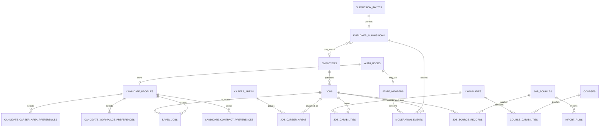

# WildJobs beta database design

**Status:** Approved on 2026-10-28

**Implementation:** The empty hosted beta schema was created and verified on 2026-10-28. The application is not connected and no vacancy, candidate or submission data has been seeded.

This design translates the approved beta foundation into an independent WildJobs database. It is deliberately limited to trustworthy vacancy publication, public course-aware discovery, candidate saves and preferences, and controlled staff moderation.

## Design principles

1. WildJobs owns its application data and Supabase project. It does not share a database with WildNews, LearnWorlds or another WildTeam service.
2. Public visitors can read only current, approved catalogue records.
3. Candidates can read and change only their own profile, saves and explicit preferences.
4. Employer submissions require a valid invitation and server-side validation. A submission never publishes a job.
5. Staff permissions come from an active WildJobs staff record, never user-editable account metadata.
6. Server credentials are restricted to trusted ingestion and submission routes and are never sent to a browser.
7. Every table in the exposed `public` schema has Row Level Security, explicit grants and tested policies.
8. Personal information is minimised. Candidate email remains in Supabase Auth rather than being copied into application tables.
9. Records are normally archived through lifecycle states rather than hard-deleted when provenance or moderation evidence must remain.

## Relationship overview

`auth.users` is managed by Supabase Auth. The application does not duplicate passwords, sessions or candidate email addresses.

## Table design

All application identifiers use `bigint generated always as identity` unless a table is keyed directly by the Supabase Auth user UUID. Public URLs use unique, human-readable slugs rather than exposing internal identifiers.

### Public catalogue

#### `employers`

Owns the reviewed employer profile.

Key fields:

- `id`, `slug`, `name`, `short_name`
- `status`: `draft`, `in_review`, `published` or `archived`
- `website_url`, `website_domain`, `focus`, `mission`, `overview`, `culture`
- `locations` and `benefits` as ordered text arrays for display-only content
- `reviewed_at`, `published_at`, `created_at`, `updated_at`

Names and domains support duplicate warnings but are not forced unique because distinct organisations can legitimately have similar names or shared domains. The slug is unique.

#### `jobs`

Owns the reviewed WildJobs version of a vacancy.

Key fields:

- `id`, `slug`, `employer_id`, `title`, `summary`
- `description`, `responsibilities`, `requirements` as accessible Markdown text
- `status`: `draft`, `in_review`, `published`, `expired`, `withdrawn` or `rejected`
- `location_text`, `country_code`, `region`, `workplace_type`
- `contract_type`, `hours_type`, `experience_level`, `is_field_based`
- `salary_text`, `salary_min`, `salary_max`, `salary_currency`, `salary_period`
- `application_url`, `application_notes`
- `posted_at`, `closes_at`, `published_at`, `withdrawn_at`
- `created_at`, `updated_at`

`workplace_type`, `contract_type`, `hours_type`, `experience_level`, `salary_period` and lifecycle status use named check constraints. Salary uses exact numeric fields for filtering and a reviewed display string for honest presentation. `closes_at`, salary text, location, application URL and an employer are required before publication.

A stored `tsvector` search column combines the job title, summary, description, responsibilities, requirements and location. Employer names are searched through the indexed employer record rather than copied into every job.

#### `career_areas` and `job_career_areas`

Career areas are staff-managed reference records with a unique slug, title, description, display order and active flag. The join table allows a role to belong to more than one area.

#### `courses`, `capabilities`, `course_capabilities` and `job_capabilities`

These tables implement course-aware discovery without learner data.

- `courses` stores the stable LearnWorlds course identifier, WildJobs slug, approved public title, short title, summary, public URL, availability state, provenance and review date.
- `capabilities` stores editorial capability topics with stable slugs and descriptions.
- `course_capabilities` records reviewed capabilities taught by a course.
- `job_capabilities` records reviewed capabilities needed or developed in a job.

A course filter matches jobs through shared capabilities. It does not claim that a candidate enrolled in or completed a course.

The four approved homepage routes are derived from structured fields:

- Closing soon: published jobs ordered by `closes_at` within an agreed time window.
- Early-career roles: published jobs at the approved early-career experience levels.
- Remote and hybrid: published jobs with the corresponding workplace types.
- Field-based: published jobs where `is_field_based` is true.

This avoids a separate collection table until editorial evidence shows that manually assembled collections are needed.

### Candidate-owned data

#### `candidate_profiles`

One row per candidate account, keyed by `user_id uuid` referencing `auth.users(id)` with cascade deletion. It stores only onboarding state and timestamps in the beta. Email remains in Supabase Auth.

The application creates this row after the first authenticated session. Signup does not depend on a database trigger that could accidentally block Auth account creation.

#### `saved_jobs`

Uses `(user_id, job_id)` as its primary key and stores `saved_at`. A candidate can save a job once and can remove the save. The reverse `job_id` index supports job lifecycle and deletion operations.

#### `candidate_preferences`

One row per candidate with `preferred_location`, `experience_level`, `created_at` and `updated_at`. These are explicit discovery choices, not eligibility decisions.

#### Preference join tables

- `candidate_career_area_preferences(user_id, career_area_id)`
- `candidate_workplace_preferences(user_id, workplace_type)`
- `candidate_contract_preferences(user_id, contract_type)`

Composite primary keys prevent duplicates. Each table cascades when the candidate profile is deleted. Preferences never contain inferred sensitive traits.

### Sources and ingestion

#### `job_sources`

Staff-managed source definitions with `name`, `source_type`, authoritative base URL, active flag and timestamps. The initial types are `manual_curation`, `employer_submission`, `feed` and `api`; only explicitly approved sources are active.

#### `job_source_records`

Preserves provenance without retaining an unnecessary raw copy of third-party content.

Key fields:

- `source_id`, optional `job_id`
- `external_id`, `canonical_url`, `content_hash`
- `source_updated_at`, `first_seen_at`, `last_seen_at`, `verified_at`
- mapping and duplicate-review status

Partial unique indexes prevent duplicates for non-null external identifiers and canonical URLs within a source.

#### `import_runs`

Stores source, lifecycle status, start and finish times, aggregate counts and a bounded error summary. It does not store credentials, tokens or full third-party payloads.

Automated imports use server-only credentials. Staff can inspect run history but cannot retrieve connection secrets because none are stored here.

### Controlled employer submissions

#### `submission_invites`

Stores a hash of the single-use invitation token, optional employer match, expiry, use time and the staff creator. Plain invitation tokens are never stored. This table is not readable by candidates or public visitors.

#### `employer_submissions`

Stores the submitted vacancy draft separately from approved jobs.

Key fields include:

- invitation and optional matched employer
- contact name and work email
- organisation name, role title, salary text, closing date and location
- workplace type, role summary and authoritative application URL
- authority confirmation time
- status, completeness score, received time and resolution time

The initial statuses are `new`, `changes_requested`, `ready_for_job_review`, `accepted` and `rejected`. Acceptance creates or updates a separate reviewed job; it does not turn the submission row into public content.

The public form submits to a protected Next.js Route Handler. The handler validates the invitation, input, rate limit and authority confirmation before using server-only database access. There is no anonymous direct-table insert policy.

### Staff and audit evidence

#### `staff_members`

Keyed by `user_id uuid` referencing `auth.users(id)`. It stores an active flag and a constrained role such as `reviewer` or `admin`. Candidates cannot create or change staff records. Authorization never uses `user_metadata`.

#### `moderation_events`

An append-only record of important job and submission decisions.

- Exactly one of `job_id` or `employer_submission_id` is present.
- `actor_user_id` identifies the active staff member.
- `action`, previous status, next status, optional review note and timestamp are recorded.
- Browser roles receive no update or delete permission.

Publication and status changes should be written transactionally with their moderation event so that the audit trail cannot drift from the record state.

## Access and Row Level Security model

| Data group                                           | Public visitor | Candidate              | Active staff           | Trusted server                            |
| ---------------------------------------------------- | -------------- | ---------------------- | ---------------------- | ----------------------------------------- |
| Published, current jobs and employers                | Read           | Read                   | Read all; manage       | Read and manage where required            |
| Career areas, active courses and capability mappings | Read           | Read                   | Manage                 | Manage where required                     |
| Candidate profile, saves and preferences             | None           | Own rows only          | No routine access      | Account-support operations only           |
| Sources, source records and import runs              | None           | None                   | Read and review        | Ingest and manage                         |
| Submission invites and employer submissions          | None           | None                   | Review and manage      | Validate invitation and create submission |
| Staff membership                                     | None           | Own active record only | Own active record only | Admin provisioning only                   |
| Moderation events                                    | None           | None                   | Read and append        | Append during trusted operations          |

Policy requirements:

- `anon` and normal `authenticated` users can select a job only when its status is `published`, its publication time has arrived, its closing date has not passed and it is not withdrawn.
- Public employer and taxonomy reads are similarly limited to published or active records.
- Candidate ownership policies use `(select auth.uid()) = user_id`, backed by indexes.
- Candidate updates include both `using` and `with check`; the ownership key cannot be reassigned.
- Staff policies require an indexed, active `staff_members` row for `(select auth.uid())`.
- Staff membership, invitation creation and server ingestion are provisioned through trusted server operations, not self-service RLS policies.
- Every table receives explicit grants. RLS does not replace table privileges.
- No view is exposed unless it uses `security_invoker = true` and its underlying policies have been tested.
- No `security definer` function is introduced merely to bypass a policy. Any genuinely necessary privileged function lives outside the exposed schema, sets an empty search path, checks the caller explicitly and has minimal execute grants.
- The Supabase secret or legacy service-role key is never placed in a `NEXT_PUBLIC_` variable or browser bundle.

## Deletion and retention behaviour

- Deleting a candidate account cascades through the WildJobs candidate profile, saves and preferences. It does not affect LearnWorlds.
- Deleting an Auth user requires session revocation as part of the account-deletion flow because deleting the user alone does not immediately invalidate every existing access token.
- Jobs and employers are normally expired, withdrawn or archived. Hard deletion is reserved for erroneous test data and approved privacy correction.
- Source records and moderation events are retained long enough to explain publication decisions, but must not become an unbounded store of copied third-party content or personal information.
- Employer-submission contact information and detailed import errors require an approved retention period before production launch. The implementation will support scheduled anonymisation or deletion once that period is agreed.
- Provider backup retention is documented separately when the Supabase project and plan are selected.

## Index and query plan

The first migration set should include:

- Unique indexes for all public slugs and the stable LearnWorlds course identifier.
- An index on every foreign-key column not already covered by the left edge of a primary or unique index.
- A partial index for public vacancy browsing on publication state, closing date, publication date and ID.
- A GIN index on the stored job search vector and a corresponding employer search index.
- Reverse indexes on career-area, capability and course mapping joins.
- Candidate ownership and RLS indexes, including `saved_jobs(user_id, saved_at desc)` and a separate `saved_jobs(job_id)` index.
- Partial unique source indexes for non-null external identifiers and canonical URLs.
- Staff moderation indexes on status, received time and unresolved records.

Public result pagination uses a stable cursor containing the selected sort value and job ID rather than increasingly expensive deep offsets.

## Migration sequence

Migration files will be created with the installed Supabase CLI only after the local design and project setup are approved. The intended order is:

1. Application schemas, required extensions and constrained reference types.
2. Employers, jobs, career areas, courses and capability mappings.
3. Sources, provenance, imports, invitations, submissions, staff and moderation records.
4. Candidate profiles, saved jobs and explicit preferences.
5. Search columns, foreign-key indexes, partial indexes and pagination indexes.
6. Explicit grants, RLS enablement and policies for every exposed table.
7. Reviewed reference data using stable slugs or external identifiers rather than generated database IDs.
8. Local RLS and lifecycle verification tests.

The sequence can be split into smaller reversible migrations during implementation. Generated migration filenames are not invented manually.

## Verification requirements

Before any migration reaches production:

1. Start from an empty local database and apply every migration in order.
2. Verify that an anonymous request sees only public, current catalogue records.
3. Verify that two candidate accounts cannot read, change or delete each other's profile, saves or preferences.
4. Verify that a normal candidate cannot read drafts, imports, source records, submissions, staff records or moderation events.
5. Verify that an inactive staff member loses staff access after session refresh and that sensitive operations revalidate the session where required.
6. Verify that a submission cannot bypass invitation validation or publish a job.
7. Verify every status transition and its moderation event commit or fail together.
8. Test expired and withdrawn jobs, duplicate source identifiers, account deletion and cascades.
9. Run Supabase security and performance advisors and resolve applicable findings.
10. Generate TypeScript database types only after the applied schema passes these checks.

## Explicitly excluded

This database does not include:

- Job alerts or delivery history.
- CVs, applications or uploaded candidate documents.
- Employer payments or public self-service publishing.
- Learner accounts, purchases, course progress or certificates.
- Guessed LearnWorlds links based on matching email addresses.
- Shared WildTeam identity or cross-application profiles.
- Marketing subscriptions or consent evidence owned by Brevo.
- A central analytics event warehouse.

## Approval checkpoint

The approved design authorised the Supabase folder structure and reviewed hosted beta foundation. Connecting the application, seeding vacancy data and enabling analytics remain separate implementation stages.

Before external beta users are invited, separate approval is still required for the employer-submission contact retention period, import-error retention period, first vacancy sources, production SMTP provider and approved LearnWorlds course input set.
